<div align="center">


<a href="https://github.com/kayk61">
  
</a>


</div>

---

## 👨‍💻 Sobre mim

Olá! Sou **Kayk**, estudante de programação e entusiasta de tecnologia. Estou construindo meus conhecimentos em desenvolvimento de software, lógica de programação e bancos de dados.

<ul>
  <li>🎓 Atualmente, estou <strong>estudando programação</strong>.</li>
  <li>💻 Minhas tecnologias de estudo são <strong>C#, Java e MySQL</strong>.</li>
  <li>🧠 Tenho interesse em <strong>desenvolvimento back-end e bancos de dados</strong>.</li>
  <li> 🛠️ Uso o GitHub para registrar minha evolução e organizar meus projetos.</li>
  <li>🚀 Meu objetivo é <strong>aprender, praticar e melhorar a cada projeto</strong>.</li>
</ul>

<br clear="right" />

## 🛠️ Tecnologias que estou aprendendo

<div align="center">


<br/><br/>


</div>

> As estatísticas dependem dos dados públicos do GitHub e da disponibilidade do serviço externo.

## Contribuições

<p align="center">
  
</p>

[Animação por contribution-fx](https://github.com/Sur1ive/contribution-fx)

## Atividades

[Listas de exercícios e estudos](https://github.com/kayk61/atividades)  
[Java](https://github.com/kayk61/atividades#java) · [C#](https://github.com/kayk61/atividades#csharp) · [SQL](https://github.com/kayk61/atividades#sql) · [Modelagem](https://github.com/kayk61/atividades#modelagem)

## Projetos

[Portfólio de projetos](https://github.com/kayk61/projetos)  
[Java](https://github.com/kayk61/projetos#java) · [C#](https://github.com/kayk61/projetos#csharp) · [SQL](https://github.com/kayk61/projetos#sql) · [Arduino](https://github.com/kayk61/projetos#arduino)

## 🎯 Meus objetivos

```text
📌 Aprender e praticar todos os dias
📌 Criar projetos para fortalecer meu portfólio
📌 Evoluir em C#, Java e MySQL
📌 Compartilhar meu progresso no GitHub
```

## 🌐 Onde me encontrar

<div align="center">

<a href="https://github.com/kayk61"></a>

<br/><br/>


</div>


[Origem dos arquivos](ORIGENS.md)
